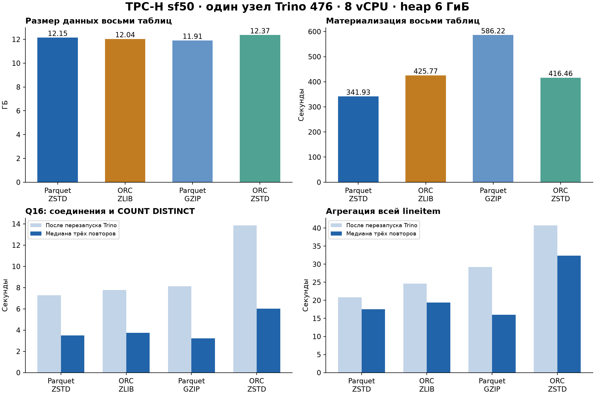

# Отчёт по практической работе №1

Развёртывание локального Lakehouse, ELT и сравнение форматов и сжатия.

## 1. Вариант и масштаб

| Поле | Значение |
|---|---|
| ФИО, как в таблице вариантов | Баланов Артём |
| Вариант | 4, TPC-H Q16 «Parts/Supplier Relationship» |
| Масштаб | tpch.sf50 во всех слоях и сравнениях |
| Объём | Полный TPC-H sf50: номинально примерно 50 ГиБ исходного набора в масштабе TPC-H до колоночного кодирования и сжатия. Это не побайтное измерение исходного набора; фактические размеры файлов измерены отдельно. |
| Почему sf50 | Масштаб соответствует заданному большому набору и помещается на локальном диске. Для Q16 используются три таблицы, а оставшиеся пять загружены для сравнения форматов на полном наборе. |
| Дата выполнения | 17 октября 2026 года |

В [TPC-H specification, §4.1.3](https://www.tpc.org/tpc_documents_current_versions/pdf/tpc-h_v3.0.1.pdf) SF1 соответствует приблизительно 1 ГиБ. Для учебного эксперимента используется произвольный SF50, который допускает [генератор Trino](https://trino.io/docs/current/connector/tpch.html). Номинальный SF не является измерением физических файлов. Все восемь таблиц действительно материализованы в каждом из четырёх вариантов; полные таблицы не заменялись выборкой.

## 2. Поднятые сервисы и выбор технологий

| Сервис | Роль | Обоснование |
|---|---|---|
| Silo, форк MinIO | S3-совместимое объектное хранилище | Сохраняет S3 API и подход гайда. Образы MinIO из гайда вернули 401 при скачивании, поэтому использован фиксированный выпуск Silo. Отдельные бакеты физически разделяют слои. |
| PostgreSQL 17 | Служебная БД Lakekeeper | Хранит состояние каталога и поддерживает транзакции. Файлы таблиц сюда не загружаются. Использован отдельный именованный том. |
| Lakekeeper | Iceberg REST Catalog | Один каталог таблиц доступен Trino и Spark через открытый REST-интерфейс. Состояние таблицы не привязано к одному движку. |
| Trino 476 | ELT, SQL и бенчмарк | Имеет детерминированный генератор tpch, чтение и запись Iceberg, Parquet и ORC. Позволяет провести эксперимент одним движком. |
| Apache Spark 3.5.5 | Дополнительный инструмент, часть 6.2 | Читает существующие Iceberg-таблицы Bronze через тот же REST-каталог и S3. Проверяет совместимость и выполняет агрегацию без предварительного экспорта в отдельный формат. |

Развёртывание описано в `compose.yaml`, каталогах `catalog/` и `trino/`. Образы движков, хранилища и каталога закреплены digest. Все команды запускаются из корня репозитория:

```powershell
docker compose up -d storage postgres catalog trino
python scripts/lab.py init
python scripts/lab.py core
python scripts/lab.py evolution
python scripts/lab.py benchmark
python scripts/lab.py audit
python scripts/lab.py inventory
.\Run-Lab.ps1 -Action spark
```

Первая команда создаёт сервисы, сеть и именованные тома. `init` создаёт бакеты, warehouse и схемы, затем сохраняет список сервисов и digest образов. `core` строит медальон и проверяет Q16. `benchmark` создаёт остальные варианты и выполняет замеры. Spark запущен отдельной командой; во время основного бенчмарка его вычисления остановлены. Подробные инструкции и адреса подключения приведены в `README.md`.

Оборудование: AMD Ryzen 7 8845H w/ Radeon 780M Graphics; память компьютера 27.81 ГиБ; Docker 13.55 ГиБ, 16 логических CPU. Trino ограничен 8 vCPU и 8 ГиБ памяти контейнера, JVM heap 6 ГиБ, память запроса до 4 ГиБ. Это один coordinator, который также выполняет задачи. На хосте работали и другие контейнеры; ресурсы не выделялись эксклюзивно, поэтому абсолютные времена зависят от фоновой нагрузки.

## 3. Разбор Q16

| Таблица | Нужные колонки | Использование |
|---|---|---|
| part | partkey, brand, type, size | Соединение с partsupp, фильтры бренда, типа и размеров, группировка и вывод. |
| partsupp | partkey, suppkey | Связь детали с поставщиком и COUNT(DISTINCT suppkey). |
| supplier | suppkey, comment | Исключение поставщиков, в комментарии которых встречается шаблон %Customer%Complaints%. |

Исходный SQL приведён в `sql/03_reference_q16.sql`. Результат показывает число разных поставщиков для группы бренд–тип–размер. Один поставщик, поставляющий несколько деталей одной группы, учитывается один раз. Порядок чтения Gold задаётся явно через `ORDER BY supplier_cnt DESC, brand, type, size`: порядок строк в файле не считается гарантией сортировки запроса.

## 4. Решения по слоям

Размеры в таблицах — сумма `file_size_in_bytes` активных data-файлов Iceberg. 1 МБ = 1 000 000 байт, 1 ГБ = 1 000 000 000 байт. Количество строк дополнительно получено SQL `SELECT count(*)`, результаты сохранены в `results/audit.json`. Метаданные учитываются отдельно в разделе 5.

### Bronze

Все исходные колонки сохранены, строки не обновляются и не удаляются. Таблицы один раз загружены `CREATE TABLE AS SELECT * FROM tpch.sf50.<table>`. Формат Parquet/ZSTD выбран для основного слоя; альтернативы изолированы в `bench`. Партиционирование не задано: Q16 не имеет фильтра по дате, а разбиение по высококардинальным ключам увеличило бы число небольших файлов. Целевой максимальный размер data-файла — 256 МБ; это верхняя цель, а не гарантия заполнения каждого файла.

| Таблица | Колонки | Строк | МБ | Файлов | Формат / кодек | Партиции |
|---|---|---|---|---|---|---|
| supplier | suppkey, name, address, nationkey, phone, acctbal, comment | 500 000 | 26.02 | 1 | Parquet / ZSTD | нет |
| part | partkey, name, mfgr, brand, type, size, container, retailprice, comment | 10 000 000 | 208.81 | 12 | Parquet / ZSTD | нет |
| partsupp | partkey, suppkey, availqty, supplycost, comment | 40 000 000 | 1 392.26 | 12 | Parquet / ZSTD | нет |
| region | regionkey, name, comment | 5 | 0.0009 | 1 | Parquet / ZSTD | нет |
| nation | nationkey, name, regionkey, comment | 25 | 0.0019 | 1 | Parquet / ZSTD | нет |
| customer | custkey, name, address, nationkey, phone, acctbal, mktsegment, comment | 7 500 000 | 408.02 | 12 | Parquet / ZSTD | нет |
| orders | orderkey, custkey, orderstatus, totalprice, orderdate, orderpriority, clerk, shippriority, comment | 75 000 000 | 1 965.44 | 16 | Parquet / ZSTD | нет |
| lineitem | orderkey, partkey, suppkey, linenumber, quantity, extendedprice, discount, tax, returnflag, linestatus, shipdate, commitdate, receiptdate, shipinstruct, shipmode, comment | 300 005 811 | 8 148.68 | 43 | Parquet / ZSTD | нет |

### Silver

`eligible_parts` оставляет бизнес-поля деталей, проверяет обязательные ключи и значения, применяет фильтры Q16 и `trim` к текстовым атрибутам. `part_suppliers` соединяет разрешённые детали с поставками и поставщиками, исключает жалобы и обогащает связь атрибутами бренда, типа и размера. При повторяющихся поставщиках внутри группы Gold сохраняет семантику `COUNT DISTINCT`. Исходный TPC-H уже согласован: очистка не выдумывает отсутствующие ошибки, а проверки подтверждают качество входа.

| Таблица | Колонки | Строк | МБ | Формат / кодек | Партиции | Обоснование |
|---|---|---|---|---|---|---|
| eligible_parts | partkey, brand, type, size | 1 484 993 | 4.57 | Parquet / ZSTD | нет | Колоночное чтение и компактное хранение; слою не нужно разбиение по дате. |
| part_suppliers | partkey, suppkey, brand, type, size | 5 937 099 | 18.88 | Parquet / ZSTD | нет | Колоночное чтение и компактное хранение; слою не нужно разбиение по дате. |

### Gold

| Таблица | Колонки | Строк | МБ | Формат / кодек | Партиции | Обоснование |
|---|---|---|---|---|---|---|
| supplier_counts | brand, type, size, supplier_cnt | 27 840 | 0.0748 | Parquet / ZSTD | нет | Компактная витрина читает готовый агрегат и не повторяет тяжёлые соединения. Партиции только усложнили бы маленькую таблицу. |

Первые пять строк витрины:

| brand | type | size | supplier_cnt |
|---|---|---|---|
| Brand#21 | PROMO POLISHED TIN | 36 | 344 |
| Brand#24 | STANDARD ANODIZED BRASS | 9 | 344 |
| Brand#41 | SMALL PLATED COPPER | 3 | 340 |
| Brand#44 | PROMO POLISHED NICKEL | 49 | 340 |
| Brand#42 | MEDIUM ANODIZED NICKEL | 49 | 339 |

### Проверка расчёта

Полное сравнение отсортированных строк исходного Q16 на `tpch.sf50`, Q16 на Bronze и чтения Gold дало совпадение. Это сравнение всех строк, а не только первых пяти. SHA-256 JSON-представления результата: `c0d1ab411f580af0b318b92638d0d87e84c43821c317b5159ea373d942f0ea1a`.

| Проверка | Найдено нарушений |
|---|---|
| supplier_null_or_invalid_key | 0 |
| part_null_or_invalid_key | 0 |
| supplier_duplicate_keys | 0 |
| part_duplicate_keys | 0 |
| partsupp_duplicate_pairs | 0 |
| orphan_part | 0 |
| orphan_supplier | 0 |
| complaint_supplier_in_silver | 0 |

Результат и исходные идентификаторы запросов: `results/gold.csv`, `results/gold.json`, `results/checks.json`, `results/queries.jsonl`.

## 5. Бенчмарк форматов и кодеков

### Методология

В каждой конфигурации материализованы одни и те же восемь таблиц `tpch.sf50` с теми же колонками. Время записи — клиентское монотонное время от отправки CTAS до завершения commit Iceberg, суммированное по восьми таблицам. Оно включает генерацию TPC-H, кодирование, сжатие, S3-запись и commit; это не изолированная скорость компрессора. Запись каждого набора измерена один раз. Порядок конфигураций фиксирован: Parquet/ZSTD, ORC/ZLIB, Parquet/GZIP, ORC/ZSTD. Первый набор создавался до построения медальона, остальные после него. Эти условия ограничивают выводы о небольших различиях во времени записи.

Trino 476 принимает кодек через сессионное свойство `bronze.compression_codec` или `bench.compression_codec`. Табличное свойство `compression_codec` этой версией не поддерживается. В Python свойство передаётся заголовком `X-Trino-Session`; в SQL-консоли используется `SET SESSION bench.compression_codec='GZIP'`. Настройка GZIP для ORC физически дала ZLIB/DEFLATE, что проверено чтением файла. Это явно показано в названиях, а не приравнено к формату контейнера gzip.

Для чтения выполнены два запроса: исходный Q16 и полная агрегация lineitem по `returnflag, linestatus` с количеством строк, суммой количества и выручкой. Для выручки использованы DECIMAL, чтобы результат сравнивался точно и не зависел от порядка суммирования DOUBLE. Перед каждой серией движок Trino перезапущен; выполнено пробное чтение одного ключа из маленькой region того же каталога, чтобы дождаться готовности worker. Это прогревает базовый код чтения, но не целевую таблицу. Уровни кодеков не переопределялись. Во всех конфигурациях tpch.splits-per-node=8 и task.concurrency=8, партиционирование отсутствует. Выполнены один первый целевой запрос и три последовательных повтора; в таблице указана медиана повторов и их диапазон. Чтение результатов включено в клиентское время. Spark во время замеров остановлен. Итоговые 32 измерения перечислены в reads.json; служебные и предварительные запросы из queries.jsonl в расчёт не включены.

Перезапуск Trino очищает его JVM и кэши, но не очищает файловый кэш ОС и хранилища. Первый запуск включает JIT и загрузку метаданных, поэтому он не обозначается как полностью холодное чтение с диска. Разницу с повторами нельзя приписать только одному виду кэша. Все результаты обеих агрегаций совпали между четырьмя конфигурациями.

| Конфигурация | Данные, ГБ | Data-файлов | Запись, с | Q16 после restart, с | Q16 медиана, с | lineitem после restart, с | lineitem медиана, с |
|---|---|---|---|---|---|---|---|
| Parquet / ZSTD | 12.15 | 98 | 341.93 | 7.28 | 3.50 | 20.86 | 17.54 |
| ORC / ZLIB (GZIP в Trino) | 12.04 | 92 | 425.77 | 7.78 | 3.76 | 24.65 | 19.42 |
| Parquet / GZIP | 11.91 | 93 | 586.22 | 8.12 | 3.22 | 29.24 | 16.01 |
| ORC / ZSTD | 12.37 | 99 | 416.46 | 13.86 | 6.02 | 40.73 | 32.37 |



Требуемое сравнение GZIP и ZSTD на трёх таблицах Bronze, необходимых Q16:

| Кодек Parquet | Размер трёх таблиц, МБ | Запись трёх таблиц, с | Q16 медиана, с |
|---|---|---|---|
| GZIP | 1 505.70 | 82.61 | 3.22 |
| ZSTD | 1 627.09 | 48.47 | 3.50 |

Диапазоны трёх повторов и прочитанные физические байты:

| Конфигурация | Запрос | min, с | max, с | Медиана physicalInputBytes, МБ |
|---|---|---|---|---|
| Parquet / ZSTD | q16 | 2.88 | 3.83 | 111.10 |
| Parquet / ZSTD | lineitem_aggregation | 15.77 | 17.56 | 1 735.90 |
| ORC / ZLIB (GZIP в Trino) | q16 | 3.63 | 4.18 | 174.41 |
| ORC / ZLIB (GZIP в Trino) | lineitem_aggregation | 19.36 | 20.64 | 2 246.74 |
| Parquet / GZIP | q16 | 3.15 | 3.83 | 148.25 |
| Parquet / GZIP | lineitem_aggregation | 15.66 | 16.50 | 1 668.35 |
| ORC / ZSTD | q16 | 5.41 | 6.20 | 190.34 |
| ORC / ZSTD | lineitem_aggregation | 32.08 | 34.72 | 2 353.33 |

### Метаданные

Внешние метаданные Iceberg измерены перечислением S3-объектов `metadata/`, отдельно от `data/`. Это JSON описаний таблиц и Avro-манифесты; они не равны статистикам файлов Parquet/ORC. Встроенные footer и stripe statistics дополнительно прочитаны PyArrow из фактических файлов. Инвентаризация не подменяется `SHOW STATS`: статистика оптимизатора не является точным физическим размером хранилища.

| Конфигурация | Iceberg metadata, МБ | Доля от data+metadata, % |
|---|---|---|
| Parquet / ZSTD | 1.1685 | 0.0096 |
| ORC / ZLIB (GZIP в Trino) | 1.1630 | 0.0097 |
| Parquet / GZIP | 1.1674 | 0.0098 |
| ORC / ZSTD | 1.1639 | 0.0094 |

Пример встроенных метаданных: по одному реальному файлу `part` из каждой конфигурации. Это выборочные footer, а не сумма footer всего набора:

| Конфигурация | Фактический кодек | Строк в файле | Footer, байт | Row groups / stripes |
|---|---|---|---|---|
| Parquet / ZSTD | ZSTD | 134 031 | 1164 | 1 |
| ORC / ZLIB (GZIP в Trino) | ZLIB | 1 756 192 | 597 | 1 |
| Parquet / GZIP | GZIP | 695 655 | 1170 | 1 |
| ORC / ZSTD | ZSTD | 322 833 | 606 | 1 |

Размер встроенных метаданных зависит от количества колонок, групп строк/страйпов и статистик. Разные размеры sample-файлов ограничивают прямое сравнение их footer. Метаданные помогают пропускать ненужные файлы и столбцы, но имеют стоимость получения и разбора. На полном наборе абсолютные data-файлы существенно больше каталожных метаданных; на маленьких справочниках и витринах относительная доля метаданных может быть заметнее.

Сравнение двух кодеков Parquet на полном наборе: для ZSTD относительно GZIP размер на 2.0% больше, время записи на 41.7% меньше, медиана Q16 на 8.9% больше. Это наблюдения одного стенда с указанными выше ограничениями повторяемости.

### Интерпретация

На этом стенде минимальный объём получил Parquet / GZIP (11.91 ГБ), минимальное суммарное время материализации — Parquet / ZSTD (341.93 с). По медиане Q16 лидировал Parquet / GZIP (3.22 с), по агрегации lineitem — Parquet / GZIP (16.01 с). Один победитель не обязан лидировать по всем метрикам.

Для основного медальона оставлен Parquet/ZSTD: он читается обоими проверенными движками, уменьшает объём хранения и сохраняет приемлемую скорость. Выбор не означает универсального превосходства на другом оборудовании. Стоимость облака в рублях не вычислялась: тарифа и облачного развёртывания в задании нет. Измеренные байты и времена показывают направления затрат на хранение и вычисления.

## 6. Осмысление и дополнительный инструмент

### 6.1. Lakehouse, эволюция схемы и time travel

| Вопрос | Ответ |
|---|---|
| Зачем большие данные и lakehouse? | Когда файлы велики и их используют разные движки, S3 позволяет отдельно масштабировать хранение и вычисления. Iceberg добавляет согласованные снапшоты, схему и атомарные изменения набора файлов. Для небольшой транзакционной задачи обычная PostgreSQL может быть проще; здесь lakehouse нужен для файлового хранения, ELT и сравнения движков. |
| Что произошло при schema evolution? | В отдельной Silver-таблице evolution_demo из трёх исходных поставщиков добавлен quality_note, затем переименован в review_note. Старые строки прочитались с NULL. ADD и RENAME изменили метаданные, без загрузки Bronze заново. После UPDATE у suppkey=1 появилось checked. Откат снапшота восстановил данные; схема с review_note осталась. |
| Восстановление данных | Прочитан исходный snapshot, затем выполнен rollback_to_snapshot. Три восстановленные строки точно совпали с историческим чтением. Изменения демонстрировались на отдельной таблице, бизнес-витрина и исходные данные не переписывались. |

```sql
-- ID реально созданного исходного снапшота: 437168094408061822
SELECT * FROM silver.lakehouse."evolution_demo$snapshots";
SELECT suppkey,name,comment
FROM silver.lakehouse.evolution_demo FOR VERSION AS OF 437168094408061822
ORDER BY suppkey;
ALTER TABLE silver.lakehouse.evolution_demo
EXECUTE rollback_to_snapshot(snapshot_id => 437168094408061822);
```

При воспроизведении ID будет другим: его нужно получить из `$snapshots`, как делает `lab.py`. Доказательства: `results/evolution.json` и SQL-запросы с ID в `results/queries.jsonl`.

### 6.2. Apache Spark подключён к Bronze

Выбран Spark: это второй независимый вычислительный движок с Iceberg REST и S3FileIO. Для будущих пакетных преобразований он полезнее отдельного BI-интерфейса; дополнительная серверная БД или копия Bronze не понадобилась. Docker-сервис описан в `compose.yaml` (профиль tools), подключение и действия в консоли — в `scripts/spark_bronze.py`.

Spark проверен на первых трёх таблицах Bronze, до загрузки пяти дополнительных таблиц полного бенчмарка. Шаги: `SHOW TABLES IN bronze.lakehouse`, чтение первых пяти поставщиков, затем `GROUP BY brand` по всем 10 млн деталей. Указаны REST URI `http://catalog:8181/catalog`, warehouse `bronze`, S3 endpoint `http://storage:9000` и path-style access. Использован Spark 3.5.5 с Iceberg runtime и AWS bundle 1.9.1.

| Действие Spark | Время, с | Результат |
|---|---|---|
| tables | 4.05 | 3 строк результата |
| sample | 3.69 | 5 строк результата |
| aggregation | 2.65 | 25 строк результата |

Количество деталей в 25 группах Spark: 10 000 000. Пример: `Brand#11` содержит 399 210 деталей. Полный вывод консоли сохранён структурированно в `results/spark_bronze.json`.

## 7. Выводы

Медальон разделил исходный набор, проверенную связь деталей с поставщиками и готовый бизнес-агрегат. Совпадение Q16 с исходным генератором подтвердило сохранение логики при преобразованиях, включая DISTINCT и исключение жалоб. Формат и кодек дали измеримые различия размера, времени записи и чтения; их выбор зависит от конкретной нагрузки. Повторные чтения и перезапуск движка показали, почему сравнение требует явно описанного состояния кэшей. Общий каталог Iceberg позволил Trino и Spark использовать одни и те же файлы Bronze.

## Приложение. Все измерения записи

| Конфигурация | Таблица | Строк | МБ data | Время CTAS, с | Data-файлов | Query ID |
|---|---|---|---|---|---|---|
| Parquet / ZSTD | supplier | 500 000 | 26.02 | 5.34 | 1 | 20261017_152757_00013_y4di2 |
| Parquet / ZSTD | part | 10 000 000 | 208.81 | 12.26 | 12 | 20261017_152803_00015_y4di2 |
| Parquet / ZSTD | partsupp | 40 000 000 | 1 392.26 | 30.88 | 12 | 20261017_152815_00017_y4di2 |
| Parquet / ZSTD | region | 5 | 0.0009 | 0.38 | 1 | 20261017_153056_00052_y4di2 |
| Parquet / ZSTD | nation | 25 | 0.0019 | 0.35 | 1 | 20261017_153056_00054_y4di2 |
| Parquet / ZSTD | customer | 7 500 000 | 408.02 | 8.07 | 12 | 20261017_153057_00056_y4di2 |
| Parquet / ZSTD | orders | 75 000 000 | 1 965.44 | 59.61 | 16 | 20261017_153105_00058_y4di2 |
| Parquet / ZSTD | lineitem | 300 005 811 | 8 148.68 | 225.05 | 43 | 20261017_153205_00060_y4di2 |
| ORC / ZLIB (GZIP в Trino) | supplier | 500 000 | 24.09 | 4.69 | 1 | 20261017_154022_00006_pzbx3 |
| ORC / ZLIB (GZIP в Trino) | part | 10 000 000 | 184.50 | 12.19 | 12 | 20261017_154027_00008_pzbx3 |
| ORC / ZLIB (GZIP в Trino) | partsupp | 40 000 000 | 1 372.24 | 32.85 | 11 | 20261017_154039_00010_pzbx3 |
| ORC / ZLIB (GZIP в Trino) | region | 5 | 0.0010 | 0.35 | 1 | 20261017_154112_00012_pzbx3 |
| ORC / ZLIB (GZIP в Trino) | nation | 25 | 0.0017 | 0.34 | 1 | 20261017_154113_00014_pzbx3 |
| ORC / ZLIB (GZIP в Trino) | customer | 7 500 000 | 379.04 | 10.88 | 12 | 20261017_154113_00016_pzbx3 |
| ORC / ZLIB (GZIP в Trino) | orders | 75 000 000 | 1 754.54 | 63.91 | 16 | 20261017_154124_00018_pzbx3 |
| ORC / ZLIB (GZIP в Trino) | lineitem | 300 005 811 | 8 323.53 | 300.56 | 38 | 20261017_154228_00020_pzbx3 |
| Parquet / GZIP | supplier | 500 000 | 25.77 | 6.13 | 1 | 20261017_155332_00009_pcm4c |
| Parquet / GZIP | part | 10 000 000 | 213.32 | 17.68 | 12 | 20261017_155339_00011_pcm4c |
| Parquet / GZIP | partsupp | 40 000 000 | 1 266.62 | 58.80 | 16 | 20261017_155357_00013_pcm4c |
| Parquet / GZIP | region | 5 | 0.0009 | 0.39 | 1 | 20261017_155455_00015_pcm4c |
| Parquet / GZIP | nation | 25 | 0.0018 | 0.28 | 1 | 20261017_155456_00017_pcm4c |
| Parquet / GZIP | customer | 7 500 000 | 402.06 | 19.58 | 12 | 20261017_155456_00019_pcm4c |
| Parquet / GZIP | orders | 75 000 000 | 1 915.02 | 97.62 | 16 | 20261017_155516_00021_pcm4c |
| Parquet / GZIP | lineitem | 300 005 811 | 8 085.66 | 385.74 | 34 | 20261017_155654_00023_pcm4c |
| ORC / ZSTD | supplier | 500 000 | 23.72 | 3.43 | 1 | 20261017_160550_00007_q6av2 |
| ORC / ZSTD | part | 10 000 000 | 181.55 | 9.66 | 11 | 20261017_160554_00009_q6av2 |
| ORC / ZSTD | partsupp | 40 000 000 | 1 443.98 | 21.31 | 10 | 20261017_160604_00011_q6av2 |
| ORC / ZSTD | region | 5 | 0.0010 | 0.45 | 1 | 20261017_160625_00013_q6av2 |
| ORC / ZSTD | nation | 25 | 0.0018 | 0.40 | 1 | 20261017_160626_00015_q6av2 |
| ORC / ZSTD | customer | 7 500 000 | 374.09 | 6.84 | 12 | 20261017_160626_00017_q6av2 |
| ORC / ZSTD | orders | 75 000 000 | 1 787.43 | 50.85 | 16 | 20261017_160633_00019_q6av2 |
| ORC / ZSTD | lineitem | 300 005 811 | 8 554.91 | 323.52 | 47 | 20261017_160724_00021_q6av2 |

## Источники и воспроизводимость

Учебные материалы преподавателя: форма «отчет.md», «варианты.md», таблица «вариант.xlsx» (строка «Баланов Артём», вариант 4), «Гайд-лейкхаус-win.pdf», «Гайд-2-медальон.pdf», «Презентация к Р1. Лаб..pptx», занятия 6–8. Числа из учебных слайдов не использовались вместо собственных измерений.

Документация: [Trino Iceberg connector](https://trino.io/docs/current/connector/iceberg.html), [Iceberg configuration](https://iceberg.apache.org/docs/latest/configuration/), [Lakekeeper](https://docs.lakekeeper.io/), [Silo](https://github.com/pgsty/silo). Текущая документация Trino может описывать свойства новее версии 476; фактические возможности проверены на запущенной версии. Все числа отчёта сформированы из файлов `results/`, запросы имеют идентификаторы Trino. Файлы больших таблиц не включены в Git и воспроизводятся скриптами.
